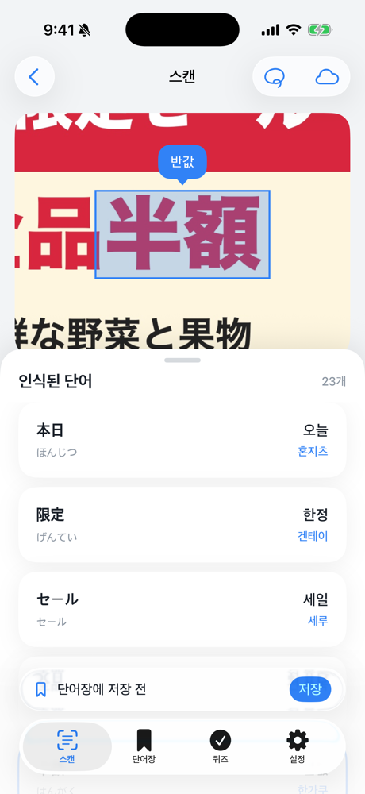
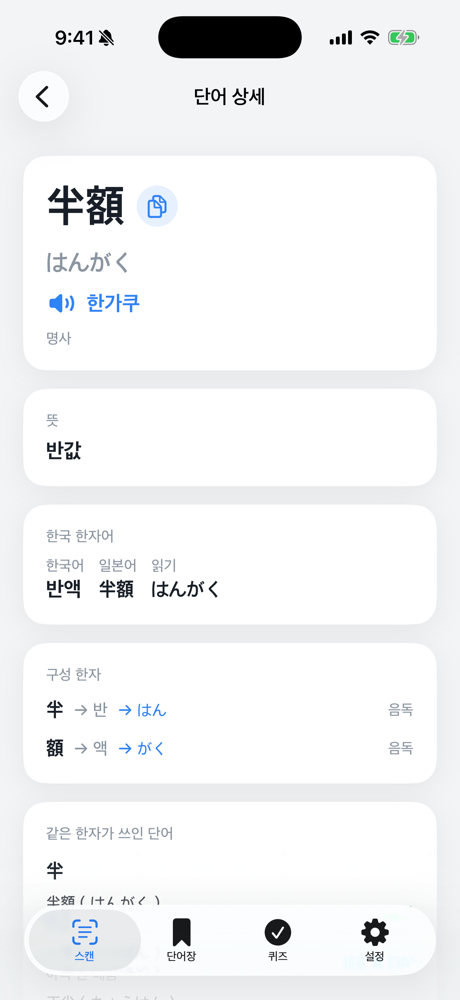
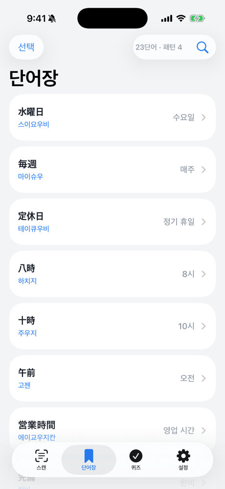
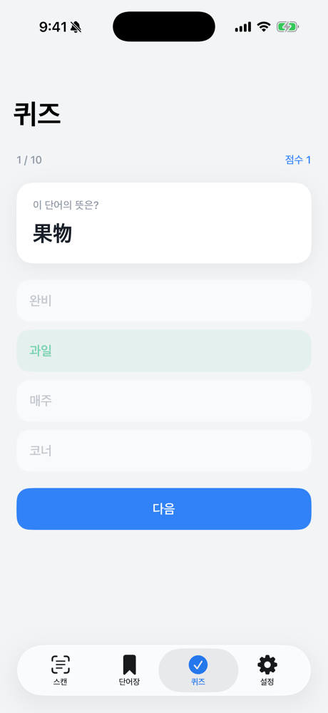

# Kanjiyomi

[](https://github.com/kut7728/Kanjiyomi/actions/workflows/test.yml)

한국어 | [日本語](README.ja.md)

일본 전단지·간판 사진 속 일본어를 단어 단위로 인식해, 뜻과 한글 발음을 보여 주는 iOS 앱입니다.
찍은 단어를 단어장에 모으고, 퀴즈와 한자 읽기 패턴으로 복습할 수 있습니다.

- SwiftUI · SwiftData · Vision · NaturalLanguage · Foundation Models
- iOS 18 이상 (온디바이스 AI·세로쓰기 문서 인식은 iOS 26 이상, 지원 기기에서만)
- 로그인 없음, 데이터는 모두 기기 안에 저장

| 스캔·하이라이트 | 단어 상세 | 단어장 | 퀴즈 |
|---|---|---|---|
|  |  |  |  |

## 주요 기능

- **스캔**: 카메라나 앨범 사진에서 일본어를 읽어 단어로 나누고, 뜻·읽기·한글 발음을 보여 줍니다. iOS 26 이상에서는 세로쓰기도 읽습니다.
- **하이라이트**: 단어를 탭하면 사진이 그 위치로 확대되고 박스와 말풍선이 뜹니다. 손가락으로 영역을 그려 그 안의 단어만 볼 수도 있습니다.
- **단어 나누기 3모드**: 사전(오프라인) / 온디바이스 AI(Foundation Models) / ChatGPT(사용자 본인 API 키).
- **오프라인 한국어 뜻**: 한국어기초사전과 위키낱말사전의 일부 항목을 번들합니다. 미수록 단어는 지원 기기의 AI로 뜻을 만들며, 생성할 수 없으면 영어 뜻을 보여 줍니다.
- **단어장·퀴즈**: 저장한 단어로 4지선다를 풀고, 저장한 단어에서 모은 한자 읽기 패턴으로 처음 보는 단어의 읽기를 추론합니다.

API 키는 앱과 저장소에 없고, 사용자가 입력한 키를 기기 Keychain에만 둡니다. 기기 밖으로 나가는 것은 ChatGPT 모드에서 보내는 인식된 글자와 단어 정보(읽기·영어 뜻)뿐이고, 사진은 보내지 않습니다.

## 사양 문서

기획부터 화면·기술·테스트·출시 준비까지의 사양은 [docs/](docs/README.md)에 있습니다.

| 단계 | 문서 |
|---|---|
| 기획 | [product-requirements.md](docs/01-planning/product-requirements.md) |
| 화면 | [03-design](docs/03-design/README.md) |
| 기술 (파이프라인, 데이터 모델, 보안) | [04-technical](docs/04-technical/README.md) |
| 테스트 | [06-testing](docs/06-testing/README.md) |

## 빌드

1. Git LFS를 설치한 뒤 clone합니다. 사전 DB(`jmdict.sqlite`)는 LFS로 관리합니다.
   ```sh
   git lfs install
   git clone https://github.com/kut7728/Kanjiyomi.git
   ```
2. `Kanjiyomi.xcodeproj`를 열고, Signing에서 본인 Team을 선택한 뒤 실행합니다.

사전 DB를 직접 만들려면 다음을 실행합니다. EDRDG와 Unicode에서 원본 데이터를 내려받습니다.

```sh
python3 tools/build_dict.py          # JMdict → entries 테이블
python3 tools/build_kanji_layer.py   # KANJIDIC2 + Unihan → 한자 패턴 테이블
```


한국어 보조 사전은 별도 `korean.sqlite`로 이미 포함되어 있습니다. 재생성하려면 빌드 스크립트에 기록된 버전·SHA-256과 같은 원본 파일을 준비합니다.

```sh
python3 tools/build_korean_dict.py \
  --krdict /path/to/krdict-json.zip \
  --wiktionary /path/to/kowiktionary.jsonl.gz \
  --jmdict /path/to/JMdict.gz
python3 -m unittest discover -s tools/tests -p 'test_*.py'
```

원본 주소는 최신본으로 바뀔 수 있습니다. 해시가 다르면 기존 DB를 보존하고 중단합니다. 새 버전으로 갱신할 때는 원본 해시·검수 기록을 함께 갱신해야 합니다. 연결 기준과 표본 검수의 한계는 [사전 조사](docs/02-research/README.md)에 있습니다.

## 데이터 출처와 라이선스

- [JMdict](https://www.edrdg.org/wiki/index.php/JMdict-EDICT_Dictionary_Project), [KANJIDIC2](https://www.edrdg.org/wiki/index.php/KANJIDIC_Project): © Electronic Dictionary Research and Development Group. [CC BY-SA 4.0](https://creativecommons.org/licenses/by-sa/4.0/)에 따라 사용하며, 이 데이터로 만든 `jmdict.sqlite`도 같은 라이선스를 따릅니다.
- [한국어기초사전](https://krdict.korean.go.kr/): © 국립국어원. [CC BY-SA 2.0 KR](https://creativecommons.org/licenses/by-sa/2.0/kr/). 일본어 대역어와 영어 뜻을 대조해 한국어 표제어를 연결했습니다.
- [한국어 위키낱말사전](https://ko.wiktionary.org/) 기여자, [Kaikki / Wiktextract](https://kaikki.org/kowiktionary/): [CC BY-SA 4.0](https://creativecommons.org/licenses/by-sa/4.0/). 일본어 항목의 한국어 뜻을 추출했습니다.
- 한국어 보조 데이터 [`korean.sqlite`](Kanjiyomi/Resources/korean.sqlite)는 일반 Git으로 배포합니다. 표기·읽기 정규화, 중복 제거, 불확실한 연결 제외를 적용했습니다. 항목별 원문 URL·식별자·원래 라이선스와 원본 날짜·해시는 DB에 포함되어 있으며, 데이터는 각 원출처의 라이선스를 따릅니다. 아래 소스 코드의 All rights reserved 표시는 사전 데이터에 적용하지 않습니다.
- [Unihan Database](https://www.unicode.org/charts/unihan.html): © Unicode, Inc. [Unicode License](https://www.unicode.org/license.txt)에 따라 사용합니다.

## 소스 코드 라이선스

이 저장소의 소스 코드는 © 2026 Kim Ui Taek, All rights reserved입니다. 읽고 참고하는 것은 자유지만, 허락 없이 복제·배포·수정할 수 없습니다. 사전 데이터는 위의 원래 라이선스를 따릅니다.

개인정보 처리방침: https://kut7728.github.io/Kanjiyomi/privacy/ · 문의: kut.support@gmail.com
